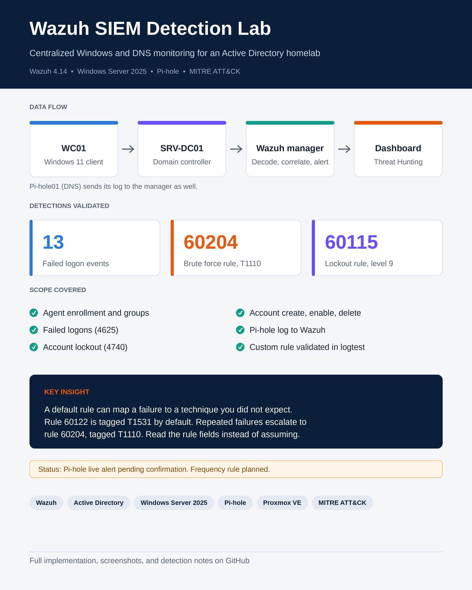
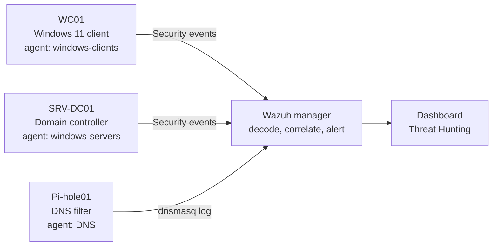
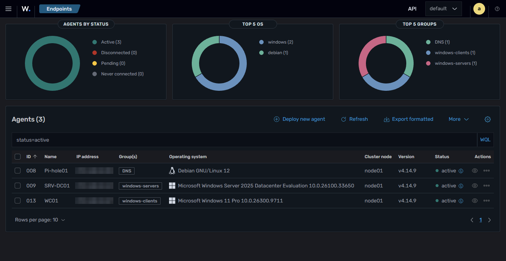
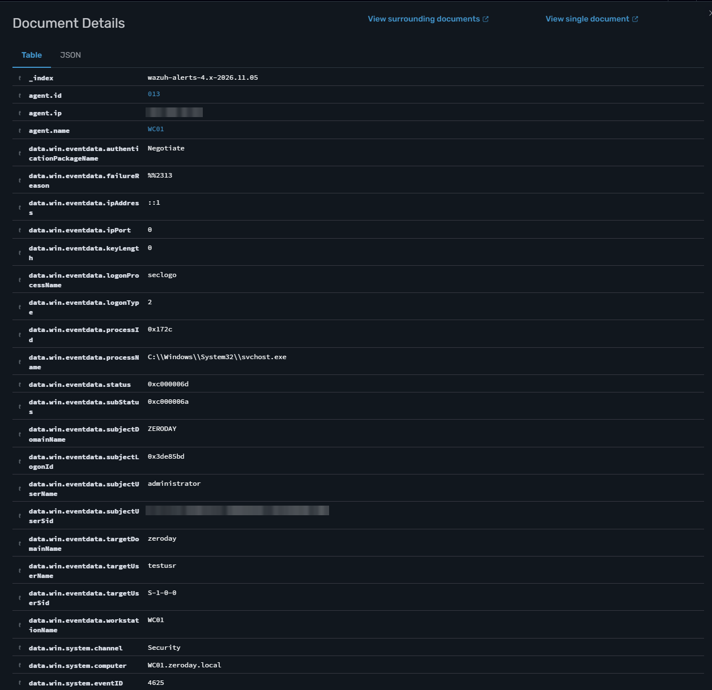
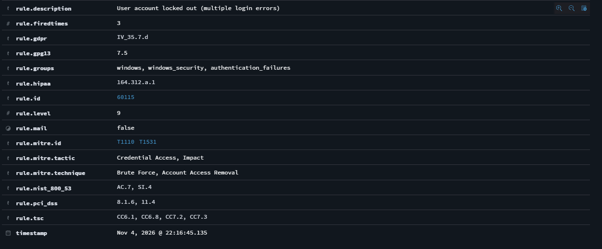

# Wazuh SIEM Detection Lab

**Centralized Windows and DNS monitoring for an Active Directory homelab, with validated detections and MITRE ATT&CK mapping.**




## Summary

I deployed a Wazuh SIEM to monitor my Active Directory homelab, then tested whether it detects the activity it should. Windows security events from the domain controller and a domain-joined workstation, plus DNS logs from a Pi-hole container, feed a central Wazuh manager. I ran controlled tests in my own lab accounts and checked each result in the dashboard.

Results are reported as tested. Anything not confirmed in the dashboard is marked as such.

## Key Results

| Detection | Source | Rule | Level | MITRE ATT&CK | Status |
| --- | --- | --- | --- | --- | --- |
| Failed logons | WC01, Event 4625 | 60122 | 5 | T1531 (Impact) | Verified |
| Repeated failures (brute force) | WC01, Event 4625 | 60204 | 10 | T1110 (Credential Access) | Verified, fired 2 times |
| Account lockout | SRV-DC01, Event 4740 | 60115 | 9 | T1110 and T1531 | Verified |
| Account created, enabled, deleted | SRV-DC01, Events 4720, 4722, 4726 | Default rules | n/a | n/a | Verified |
| Pi-hole blocked lookup | Pi-hole01, dnsmasq log | 100100 (custom) | 5 | n/a | Validated in wazuh-logtest. Live alert pending |
| Repeated blocked lookups | Pi-hole01, dnsmasq log | 100101 (custom) | 10 | n/a | Planned, not yet tested |

## Key Insight

A default rule can map an event to a technique you did not expect. A single failed logon (rule 60122) is tagged T1531 (Account Access Removal) by default. Repeated failures escalate to rule 60204, which is tagged T1110 (Brute Force). Read the rule fields instead of assuming the mapping.

## Architecture



| Host | Role | Agent name | Group |
| --- | --- | --- | --- |
| wzd | Wazuh 4.14.9 manager and dashboard | n/a | n/a |
| SRV-DC01 | Domain controller, Windows Server 2025 | SRV-DC01 | windows-servers |
| WC01 | Domain-joined Windows 11 client | WC01 | windows-clients |
| Pi-hole01 | Debian 12 LXC container, DNS filter | Pi-hole01 | DNS |



## Implementation Overview

1. **Agents:** installed the Wazuh agent on each host, then gave each one a fixed name and group through an enrollment block in `ossec.conf`. Wazuh cannot rename a registered agent, so each was deleted and registered again.
2. **Audit policy:** enabled Logon, Account Lockout, and Account Management auditing on the Windows hosts so that the events exist for Wazuh to read.
3. **Detections:** tested failed logons, brute force, lockout, and account changes, and checked the rule fields in each alert.
4. **Pi-hole integration:** added Pi-hole's log as a `localfile` source on the Pi-hole01 agent and wrote a custom rule for blocked lookups.
5. **Validation:** used `wazuh-logtest` to check rule matches, then searched the dashboard for the live alerts.

Full step-by-step guide: [`docs/Wazuh_SIEM_Implementation_Full.pdf`](docs/Wazuh_SIEM_Implementation_Full.pdf)

## Configuration Notes

Values are sanitized. Replace the placeholders with your own addresses.

**Enrollment block** (inside `<client>` in `ossec.conf`, one per host)

```xml
<client>
  <enrollment>
    <enabled>yes</enabled>
    <agent_name>SRV-DC01</agent_name>
    <groups>windows-servers</groups>
  </enrollment>
  ...
</client>
```

**Pi-hole log source** (Pi-hole01, inside `<ossec_config>`)

```xml
<localfile>
  <log_format>syslog</log_format>
  <location>/var/log/pihole/pihole.log</location>
</localfile>
```

**Custom rule** (`/var/ossec/etc/rules/pihole_rules.xml` on the manager)

```xml
<group name="local,pihole,dns,">
  <rule id="100100" level="5">
    <if_sid>70000</if_sid>
    <match>gravity blocked</match>
    <description>Pi-hole: blocked DNS query</description>
  </rule>
</group>
```

The `<if_sid>70000</if_sid>` line is required. The FreePBX decoder claims Pi-hole lines and assigns them to rule 70000, so a standalone rule never matched.

**Audit policy** (run on each Windows host as administrator)

```powershell
auditpol /set /subcategory:"Logon" /success:enable /failure:enable
auditpol /set /subcategory:"Account Lockout" /failure:enable
auditpol /set /subcategory:"User Account Management" /success:enable /failure:enable
```

## Validation

| Test | Method | Result |
| --- | --- | --- |
| Failed logons | Repeated wrong passwords with `runas` on WC01 | 4625 events recorded, rule 60122 fired |
| Brute force | Repeated failures within a short window | Rule 60204 (T1110) fired |
| Lockout | Account locked by the domain policy | 4740 on SRV-DC01, rule 60115 (level 9), caller WC01 |
| Account changes | Create, enable, and delete a test account | 4720, 4722, 4726 recorded with actor and target |
| Pi-hole rule (logic) | `wazuh-logtest` with a real blocked line | Rule 100100 matched, alert generated |
| Pi-hole rule (live) | Blocked lookup from WC01, search `rule.id: 100100` | Pending confirmation |




## Issues Encountered

| Problem | Cause | Fix |
| --- | --- | --- |
| Agent kept its old name | Wazuh cannot rename a registered agent | Deleted the agent, cleared its key, re-registered with the enrollment block |
| Lockout event missing from search | Time range did not include the event | Used an absolute range that covered the test |
| Pi-hole rule never matched | FreePBX decoder claimed the line first (rule 70000) | Set `if_sid` to 70000 on the custom rule |
| Pi-hole logs not read | Unclosed `<localfile>` block in `ossec.conf` | Replaced the block with a complete one and validated the file |
| Blocked name still resolved | Domain controller cached an earlier answer | `Clear-DnsServerCache` on SRV-DC01, `Clear-DnsClientCache` on WC01 |
| Rootcheck alert on Pi-hole01 | `/dev/.lxc` is a normal LXC artifact | Documented as a false positive |

## Limitations and Next Steps

- The live dashboard alert for Pi-hole rule 100100 is not yet confirmed. Validation so far is through `wazuh-logtest`.
- The FreePBX decoder claims Pi-hole log lines. A dedicated Pi-hole decoder would be a cleaner fix.
- The repeated-lookup frequency rule (100101) is planned and not yet tested.
- Test accounts are lab-only. Detections were tested in one lab, so thresholds were not tuned for production noise.

## Repository Structure

```
Wazuh-SIEM-Detection-Lab/
├── README.md
├── configs/
│   ├── pihole_rules.xml
│   └── enrollment-examples.md
└── screenshots/
    └── 01-endpoints.png ... (blurred)
```

## Skills Demonstrated

SIEM deployment and agent management, Windows event log analysis, Active Directory auditing, detection validation, MITRE ATT&CK mapping, log source integration, technical documentation.

## Related Projects

- [Pi-hole DNS Filtering & Visibility Lab](https://github.com/zdhomelab/Pi-hole-DNS-Security-Lab): the DNS filtering layer that feeds this SIEM.
- [Active Directory & Windows Security Lab](https://github.com/zdhomelab/AD-WS-Lab): the domain environment both projects build on.

## Disclaimer

This is a personal homelab built for learning. IP addresses and MAC addresses in screenshots are blurred. Test accounts were used for all failed-logon and lockout activity, and no production systems were involved.
